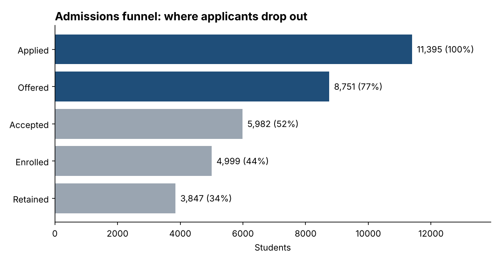
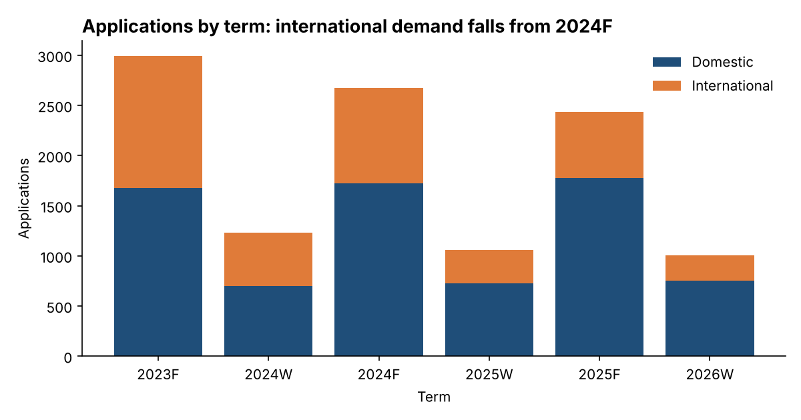
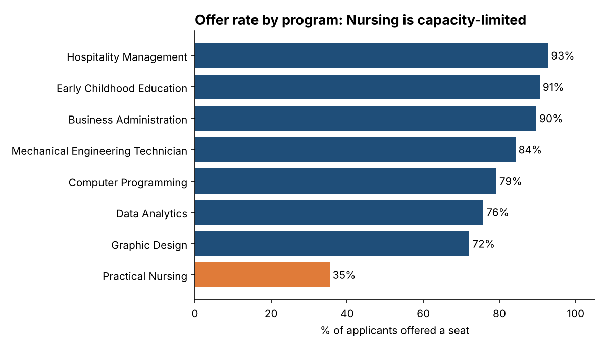
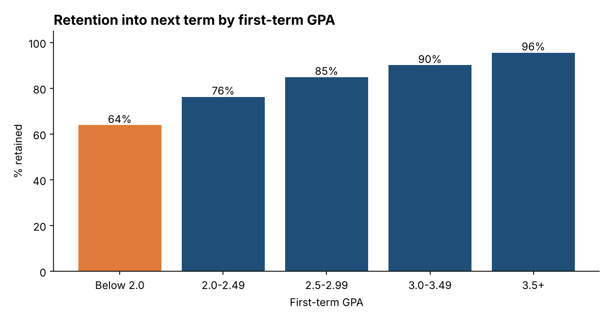

# Student Enrolment Analysis

An end-to-end data analytics project that follows college applicants through the admissions
funnel, from **application to offer, enrolment and retention into the next term**, to find
where students are lost and what to do about it. It covers the full analyst workflow: data
quality checks and cleaning in Python, loading into a SQL database, SQL analysis, charts, and
business recommendations.

> All data is **synthetic** (generated by `src/generate_data.py`). It is modelled on a
> Canadian college's admissions process but contains no real students or institution data.

## Business question

Every applicant who drops out of the funnel is lost tuition and an empty seat.
**Which programs, student groups, recruitment channels and intakes drive enrolment and
retention, and how can the college protect enrolment as international demand falls?**

## Key results

| Metric | Value |
|---|---|
| Applications analyzed | 11,395 |
| Offer rate | 76.8% |
| Yield (offers that became enrolments) | 57.1% |
| Students enrolled | 4,999 |
| Retained into next term | 84.4% |

- **International Fall applications fell 50%** from 2023F to 2025F; first-term tuition from new
  Fall students dropped from $5.59M to $3.69M.
- **International yield is 38% vs 69% domestic.** Only 67% of international students who accept
  actually enrol (91% domestic), pointing to visa and arrival barriers.
- **Practical Nursing offers seats to only 35% of applicants**; every other program offers 72-93%.
- **First-term GPA predicts retention:** 64% of students below a 2.0 GPA return, versus 96% at 3.5+.
  Winter-intake students are retained less often than Fall (81.9% vs 85.1%).

Full write-up: [`reports/findings.md`](reports/findings.md)






## Data quality

The raw file contains deliberate real-world problems. The cleaning step logs every fix
([`reports/data_quality_report.md`](reports/data_quality_report.md)):

| Check | Result |
|---|---|
| Duplicate application IDs removed | 85 |
| Program codes with stray spaces or lowercase fixed | 45 |
| Missing recruitment channel labelled "Unknown" | 69 |
| GPA values outside 0-4.0 set to missing | 28 |
| Enrolled students missing an offer flag corrected | 22 |
| Applications dated after term start removed | 18 |

## Data model

```
programs (8 rows)       program_code, name, faculty, domestic and international tuition per term
terms (6 rows)          term, intake (Fall / Winter), start date
applications (11,395)   one row per application: program, student type, age group, channel,
                        offered / accepted / enrolled flags, first-term GPA, retained next term
```

Retention for the latest intake (2026W) is not known yet, so those students are excluded
from retention rates.

## Project structure

```
src/generate_data.py      synthetic applications data with injected quality issues
src/clean_data.py         data quality checks, cleaning and logging
sql/schema.sql            SQLite tables, constraints and indexes
sql/analysis_queries.sql  KPI, funnel, program, channel, term-trend and retention queries
src/analyze.py            loads SQLite, runs queries, builds charts and findings
run_all.py                runs the whole pipeline
```

## Skills shown

Python (pandas, NumPy, Matplotlib) · SQL (CTEs, window functions with LAG, joins, CASE,
UNION) · data cleaning and validation · data modeling with constraints · funnel and cohort
analysis · KPI design · data visualization · turning analysis into business recommendations

## How to run

```bash
pip install -r requirements.txt
python run_all.py
```
